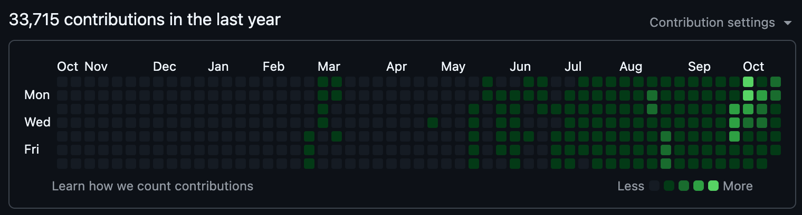

# Hey, I'm Nathan 👋

Designing and marketing since 2011 · [Agency Astro](https://agencyastro.com) and [Launch Astro](https://github.com/LaunchAstro)

I set the strategy, then build the websites, automations and AI systems that carry it out.

         

## Start here

- **[ops-astro](https://github.com/LaunchAstro/ops-astro)**: an operations platform for organisations. Records, knowledge, tasks and agent work in one place, with a person signing off before anything big happens.
- **[work-map](https://github.com/LaunchAstro/work-map)**: when 20 agents are building at once, it's hard to see where everything's up to. This draws the whole build as a map. Mac, Windows and Linux.
- **[seat-gauge](https://github.com/LaunchAstro/seat-gauge)**: a little Mac window that shows which Claude or Codex subscription has room left, and when each one resets.
- **[claude-context-bar](https://github.com/LaunchAstro/claude-context-bar)**: one line under every Claude Code pane. Context used, session cost and quota left.

## What I'm building at [Launch Astro](https://github.com/LaunchAstro)

**[Ops Astro](https://github.com/LaunchAstro/ops-astro)** is the main thing: one place for an organisation's records, knowledge, tasks and AI agent work, with a person signing off before anything big happens, and the organisation keeping control of its data.

Next to it is a **website engine** that builds client sites from one shared template and design system, each with its own brand.

Everything else here, including the tools listed above, exists to help build those two.

## What I do

I'm the director of [Agency Astro](https://agencyastro.com), a creative and digital agency. Strategy, websites and landing pages with the copy, brand and print design, SEO and AI search, CRM and automation, and video.

## Work I'm proud of

- 13 animated artworks projected onto the **Sydney Opera House** sails for World Ocean Day.
- The **Youth Ocean Carnival** at Luna Park with 33 secondary schools, and a series of Youth Ocean Workshops.
- A learning platform, app and community for **Global Leadership Network**'s schools programme, with 400+ video lessons.
- Brand, store and a projection for Olympic diver **Sam Fricker**.

More at [agencyastro.com](https://agencyastro.com).

## Activity

Including private repos, from my own dashboard (October 2026). Most of these commits are made by my agents, and every change is reviewed before it merges.

## Connect

## Random facts

- I produce melodic techno on a hybrid Eurorack and Ableton setup.
- I talk to my agents more than I type to them. Nearly everything starts as a voice note.
- I first opened Blender in high school, back in 2007 or 2008. Started doing design work for clients in 2011.
